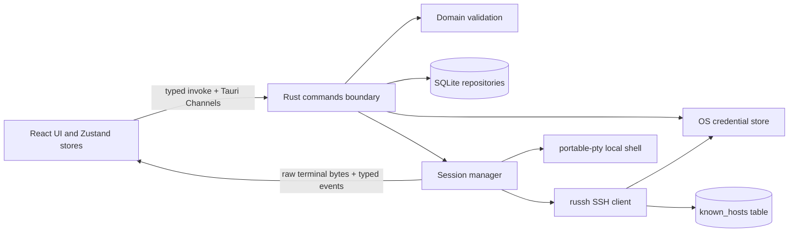

# TermLink architecture

## Scope

Milestone 1 is a Windows-first Tauri desktop client with real SSH shells and local terminals. The UI is a React/TypeScript application; SQLite, protocol sessions, OS credential access and filesystem dialogs stay in the Rust process. The webview has no direct filesystem or shell API.

## Frontend

- `src/features/` owns connection, terminal, settings, history, snippets and command-palette UI.
- `src/domain/` defines the wire types and Zod schemas. Rust validation remains authoritative.
- `src/stores/` contains Zustand state for profiles/groups/snippets, application settings, sessions, confirmation prompts and view state.
- `src/lib/ipc.ts` is the only frontend transport. Session output uses a raw-byte Tauri `Channel<ArrayBuffer>`; lifecycle and security prompts use a typed event channel.
- `src/features/terminal/registry.ts` keeps one xterm instance per tab so tab switches do not discard scrollback. `controller.ts` serializes writes, coordinates resize, reconnect and cancellation.
- The test-only Vite `e2e` mode replaces IPC with an explicitly simulated backend. It is not imported by production builds.

## Native backend

- `src-tauri/src/commands.rs` is the webview trust boundary. It validates IDs and values, asks the database and service layers to perform work, and sends file dialogs through the native dialog plugin.
- `domain/` contains typed inputs, settings and validation. Deserialization rejects unknown fields for security-sensitive input shapes.
- `db/` contains SQLite repositories and the versioned SQL migration. Foreign keys are enabled, writes use transactions, and initialization refuses a database newer than the app understands.
- `credentials.rs` wraps the platform credential store. Windows uses Credential Manager, macOS uses Keychain and Linux uses Secret Service through the keyring crate. An in-memory store exists for unit tests only.
- `session/` gives every SSH or local shell an owned async task, cancellation token, command channel and output sink. Closing a tab cancels the session and closes its underlying channel or PTY process.
- `portability.rs` imports and exports versioned JSON profiles and groups. Secret values are excluded; the import path validates each profile before inserting it.

## SSH session flow

1. The frontend opens a session with a profile ID or validated quick-connect fields, terminal dimensions and two Tauri channels.
2. Rust loads the profile, resolves saved credentials from the OS store, and opens the SSH transport asynchronously.
3. During key exchange, `russh` calls the host-key handler. A known matching key continues. An unknown or changed key pauses the connection and sends a prompt with the SHA-256 fingerprint. Only an explicit user answer can accept it; a changed key can only be accepted by replacing the stored key.
4. The auth loop supports password, keyboard-interactive, private keys (including passphrases) and SSH agents where available. An accepted credential is stored only after successful authentication and only when the user selected Save.
5. Rust requests a PTY and interactive shell, then streams bytes and lifecycle events. The frontend feeds bytes directly into xterm.js and sends input and resize updates back over validated commands.

The connection timeout does not count time spent waiting for a human security or credential prompt. Prompts expire, and session cancellation interrupts pending work.

## Persistence

The initial migration is `src-tauri/migrations/0001_initial.sql`. It creates profiles, nested groups, tags, trusted host keys, session and command history, snippets, transfer history, forwarding configurations and settings. Secret values do not have SQLite columns. Profile records can indicate whether a secret is saved, and private-key profiles store a path.

SQLite stores local metadata and command history in the user's application data directory. These database contents are not encrypted by TermLink; users should rely on OS disk protection and protect their Windows account. Debug builds use a separate `dev` data directory and credential-service name.

## Build and platform boundaries

- Development: Vite on port 1420, launched by `tauri dev`.
- Production: Vite assets are embedded into the Tauri binary; the Windows bundle targets NSIS and MSI.
- Windows local terminals use ConPTY. Unix platforms use the portable PTY implementation, but macOS and Linux packaging and OS credential behavior still need platform CI and integration validation.
- SFTP, forwarding, RDP and VNC are represented as unavailable UI sections until their real adapters and tests are implemented.
